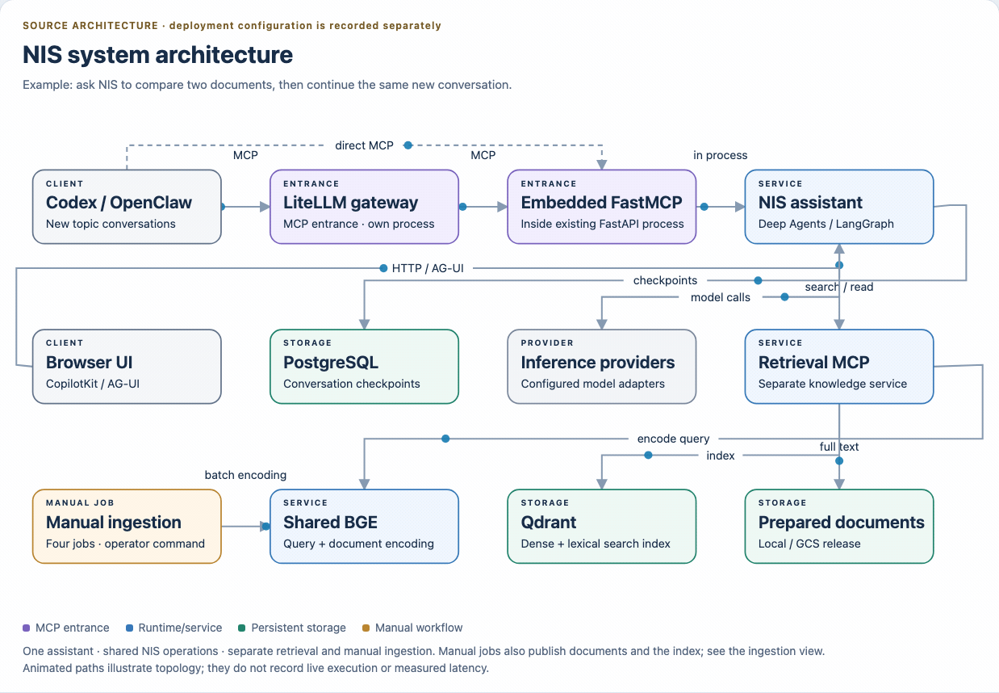

# Design System: Nora

## Overview

### Existing visual conventions

Keep the application calm and diagrams easy to inspect. The UI's green/cream
palette and diagrams' semantic colors serve different tasks. Share readable
labels, simple controls and explicit state rather than force every surface into
one palette. Values above are extracted from existing source, not a new brand.

[Local browser version](architecture/diagrams/01-system-architecture.html)

## Colors

Use the UI accent for interaction. Diagram colors distinguish responsibilities;
labels and arrows must also explain meaning without relying on color alone.

## Typography

Use system sans-serif for diagram labels and viewer controls, monospace for code.
The existing UI uses Arial/Helvetica body text and Georgia for its main heading
and letter mark. Preserve that hierarchy when making scoped UI repairs.

## Layout

The UI has one conversation column with a 1050px maximum width and a compact
mobile layout below 600px. Standalone diagrams must fit their desktop viewport;
interactive controls and explanatory details remain outside the SVG export.

## Elevation & Depth

The UI uses flat bordered surfaces. Diagrams use restrained panels and selection
feedback. Depth should expose state rather than obscure labels or connections.

## Shapes

The UI uses an 8px button radius and a 16px chat panel. Diagram nodes use rounded
rectangles and orthogonal arrows. Preserve semantic node identities when editing.

## Components

- Brand header: product name, purpose and private-workspace context.
- Status toolbar: prepared-document state and new-conversation action.
- Chat panel: the existing CopilotKit component and its keyboard behavior.
- Diagram viewer: readable title, selectable nodes, keyboard focus and export.

## Do's and Don'ts

- Keep one obvious main flow and short labels; use details for longer context.
- Retain separate conversation, ingestion and artifact-review paths.
- Export every changed HTML diagram to a matching GIF and inspect the result.
- Do not introduce ornamental assets or visual variants without a reader need.
