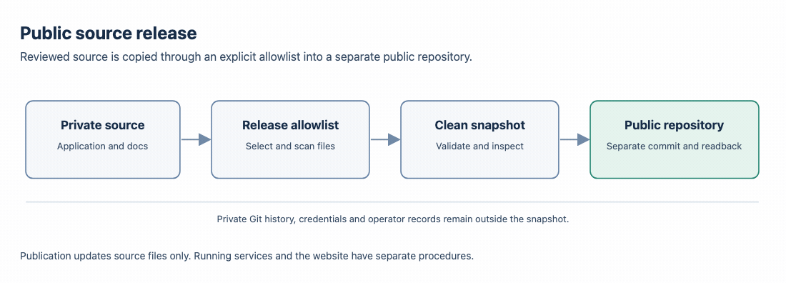

# Preparing a public source release

[Home](README.md) · [Contributing](CONTRIBUTING.md) · [Validation](evaluation/VALIDATION.md)

The public repository was created from a clean snapshot built from an explicit file list and fresh history. Each subsequent update follows the same process. The snapshot contains the shared application, portable configuration, synthetic examples, tests, documentation and license notices; it does not carry the private repository's commit history or maintainer operating records.



[Local browser version](architecture/diagrams/public-source-release.html)

## Build and inspect

From a configured development checkout:

```bash
make validate
make release
```

[release-manifest.json](release-manifest.json) owns the source file list; [public-docs.json](public-docs.json) owns Markdown coverage and the editable HTML/derived GIF diagram pairs. Include both files per pair; retire replaced active diagram assets after updating their links. The builder rejects unsafe paths, symlinks, missing files, unlisted public documents and common private key, home-directory and account-address markers. This targeted scan is useful evidence, not a guarantee that every possible sensitive string can be recognized.

The result is `.release/nora-0.1.0-source.tar.gz`. Its top-level `nora-0.1.0/` directory includes `SOURCE-CHECKSUMS.json` with each source file's SHA-256. The archive is deterministic for unchanged inputs and records no host user, group or source timestamp. It excludes `.git`, private history, credentials, model weights, caches and runtime state.

Extract it into a new directory, inspect the exact contents, then repeat the contributor checks there. The earlier five-service stack passed an isolated ARM Linux trial; the later private candidate has separate dated retained-corpus evidence. Neither result proves that a newly extracted public snapshot has been installed; see the [validation record](evaluation/VALIDATION.md) and [deployment status](setup/private-deployment/STATUS.md).

## Refresh the separate public repository

The existing public destination is `lm2000/nora-ai-knowledge-agent-harness-public`. The private source repository retains its own history. This document update does not refresh the public snapshot.

1. Review the current private source and exact [release manifest](release-manifest.json), including the current [Roadmap](Plan.md) and [Repository map](REPO_MAP.md).
2. Run the documentation, diagram and release checks; extract and inspect the resulting archive, including its checksums and credential scan. Repeat contributor checks on the extracted snapshot.
3. Update only the separate public repository from that reviewed snapshot, preserving [LICENSE](LICENSE), [NOTICE.md](NOTICE.md) and [Templates/LICENSE](Templates/LICENSE). Read back the public commit and anonymous HTTPS access.

Private originals and prior evaluation evidence remain in the maintainer's local archive. The three included example documents are fictional; they replace private material in the public reproduction route, not in historical measurements.
