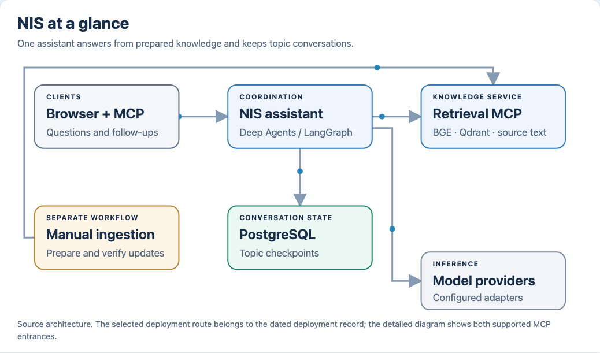

# Nora Intelligence System — Knowledge & Agent Harness

A personal knowledge assistant for answering from changing documents while
keeping conversation history, source identity and control over updates.

Michael Lvov built the application layer that connects retrieval, persistent
conversations, controlled knowledge updates and traceable artifact reviews.
This independent project includes code, architecture decisions, synthetic
examples and bounded evaluation results.

## The system

**Example:** “What still blocks the Atlas release?” The assistant retrieves the
fictional release plan and decisions, identifies the load test and rollback
rehearsal, and can continue the same conversation.



[Local browser version](architecture/diagrams/system-at-a-glance.html) · [Detailed architecture](architecture/diagrams/README.md#system-architecture) · [Architecture and trade-offs](architecture/architecture-concept.md)

One assistant serves separate topic conversations. A Next.js/CopilotKit UI and
MCP clients reach the same Coordination operation, directly or through a separate
LiteLLM gateway. Retrieval combines shared BGE embeddings, Qdrant and prepared
source text. PostgreSQL stores LangGraph conversation checkpoints. The diagram
shows source responsibilities; the [dated deployment record](setup/private-deployment/STATUS.md)
owns the selected route.

## Project implementation and upstream foundations

| Project work | Foundation it uses |
| --- | --- |
| Conversation ownership, context limits, answer checks and MCP entrance | Deep Agents, LangChain, LangGraph and FastMCP |
| Source preparation, document identity, hybrid ranking and bounded search/read | BGE, Qdrant and MCP |
| Provider adapters, capability selection and bounded fallback | LangChain model interfaces and configured inference providers |
| Browser integration, origin checks and server-side credential handling | Next.js, CopilotKit and AG-UI |
| Separate ingestion jobs, release verification and explicit activation | Python, Docker Compose and operator-selected storage |
| Saved-review validation, exact-response owner decisions and revision records | A small offline evaluation workflow |

The project supplies the application boundaries and integration code; upstream
frameworks supply agent execution, persistence primitives, protocols and models.
[Repository map](REPO_MAP.md) identifies the implementation owners.

## Three workflows

| Workflow | Example | Result |
| --- | --- | --- |
| [Question answering](agents/README.md) | Ask about Atlas and continue the conversation | A supported answer and retained conversation |
| [Knowledge ingestion](workflows/ingestion/README.md) | Add a revised guide with the retained corpus | A verified knowledge release |
| [Artifact evaluation and revision](workflows/artifact-review/README.md) | Review a draft briefing against its source plan | Feedback, owner decisions and a retained or revised version |

Artifact review uses small iterations: draft → review → decision → revision.
Accepted changes improve the material; retained lessons improve the next review
brief. Its guide explains judges, datasets, Harbor Hub and inference-provider
roles. The local commands replay saved responses rather than call those services.

## Engineering decisions

| Choice | Reason and trade-off |
| --- | --- |
| One assistant with topic checkpoints | Clients share a runtime and lifecycle; this is a private single-user system |
| Shared BGE for ingestion and retrieval | One representation boundary; batch and interactive encoding need admission control |
| Manual ingestion outside conversations | Updates are inspectable and separately activated; source freshness needs an operator procedure |
| Bounded tools, model calls and output repair | Failures remain explicit; strict limits can reject incomplete answers |
| Owner-directed artifact review | Feedback is traceable to a version; model opinions still require human judgment |

See [Decisions](Decisions.md) for the accepted choices and
[Requirements](architecture/Requirements.md) for their behavior contracts.

## Evidence

| Evidence | What it establishes |
| --- | --- |
| [Source validation](evaluation/VALIDATION.md) | Synthetic application contracts, framework integration, CLI and UI checks |
| [CPU embedding comparison](evaluation/embeddings/RESULTS.md) | BGE throughput of 12.87 vs 2.73 excerpts/s for Qwen on 17 excerpts; a small historical CPU experiment |
| [Retrieval experiments](evaluation/README.md) | Small-set ranking results and misses, with corpus and method boundaries preserved |
| [Private deployment record](setup/private-deployment/STATUS.md) | Dated client and service checks, separate from source tests |

Retrieval relevance, generated-answer quality and execution correctness are
separate questions. These results do not establish representative answer
accuracy, enterprise scale or general provider superiority.

## Try the artifact-review example

After [installing the source](setup/README.md#install-for-development), run from
the repository root with a new output directory:

```bash
nora review-example --output .private/atlas-review-cycle
```

This is a separate example from the question-answering example above. Expected
result: two synthetic reviews, explicit decisions and the corrected Atlas
briefing. It adds a missing prerequisite, rejects invented timing and avoids
duplicating an existing section. No model request is made.

For the application, real-embedding smoke test and configuration, follow
[Setup](setup/README.md). [Contributing](CONTRIBUTING.md) owns development checks.

## Explore further

- [Architecture](architecture/architecture-concept.md) and [diagrams](architecture/diagrams/README.md)
- [Workflows](workflows/README.md) and [evaluation](evaluation/README.md)
- [Roadmap](Plan.md), [repository map](REPO_MAP.md) and [configuration](setup/configuration.md)

MIT licensed. Preserve [upstream notices](NOTICE.md) and [Templates/LICENSE](Templates/LICENSE).
