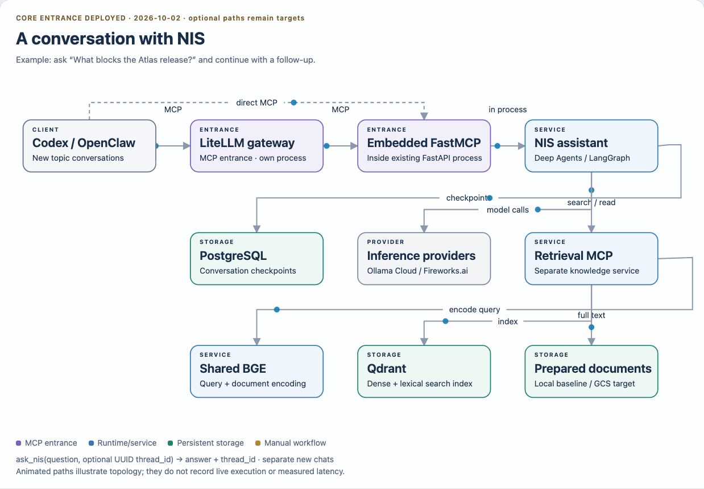
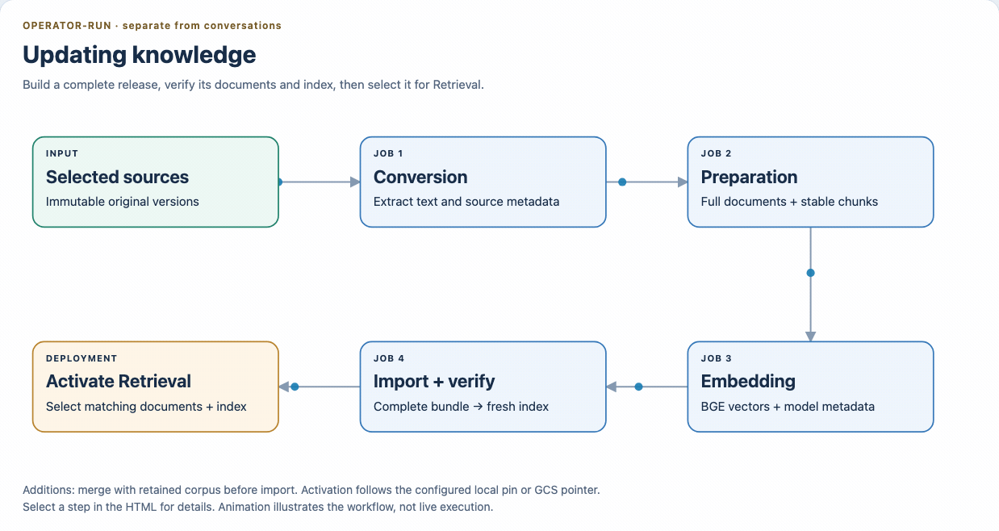

# Nora Intelligence System — Knowledge & Agent Harness

Nora Intelligence System (NIS) is a private, self-hosted knowledge assistant from Nora SuperIntelligence Lab. It retrieves relevant passages from a prepared document collection, answers through a Deep Agent, and keeps conversation history in PostgreSQL.

**Example:** ask “What still blocks the Atlas release?” Nora finds the fictional Atlas plan and decisions, then answers that the load test and rollback rehearsal remain.

One assistant handles separate topic conversations. Clients use `ask_nis(question, thread_id=None)` through a separate LiteLLM MCP gateway or directly through FastMCP embedded in Coordination. Both paths share the same runtime and PostgreSQL conversation lifecycle. See the [Coordination guide](setup/containers/coordination.md#selected-one-assistant-target--2026-10-02) for the interface.

## From question to answer



[Local browser version](architecture/diagrams/conversation.html) · [Architecture](architecture/Architecture%20Concept.md)

The main runtime has five responsibilities:

- **UI:** Next.js, CopilotKit and AG-UI.
- **Agent:** LangChain/LangGraph Deep Agent inside Coordination.
- **Retrieval:** BGE embeddings and Qdrant search through MCP.
- **Memory:** PostgreSQL conversation checkpoints.
- **Inference:** Ollama Cloud and Fireworks.ai, with optional local Ollama.

## Updating knowledge

Knowledge updates run separately from conversations: select sources, convert and prepare them, embed, then import and verify a complete release before activation. Additions are assembled with the retained corpus. Follow [Run an update](workflows/ingestion/knowledge-base-update-checklist.md) for the current local deployment or [How ingestion works](workflows/ingestion/README.md) for the technical contracts; GCS cutover remains pending.



[Local browser version](architecture/diagrams/manual-ingestion.html) · [Run an update](workflows/ingestion/knowledge-base-update-checklist.md) · [Understand the pipeline](workflows/ingestion/README.md)

## Current state

| Area | State |
| --- | --- |
| Single assistant and browser UI | Implemented in source; validated with synthetic fixtures and local UI tests |
| Shared retrieval over MCP | Implemented; BGE/Qdrant search and read tested with synthetic data |
| PostgreSQL conversation persistence | Implemented; checkpoint continuity tested with local fixtures |
| Provider abstraction and selection | Implemented; Ollama Cloud and Fireworks.ai supported, optional local Ollama |
| Ingestion maintenance | Four-stage container workflow implemented; routine live GCS refresh pending |
| Repeatable tests and limits | Synthetic contract tests, UI checks, lint, link and release checks are provided |
| Answer quality | Synthetic smoke passes; representative private evaluation remains open |

The exact evidence boundary is in [Validation](evaluation/VALIDATION.md) and [Private deployment status](setup/private-deployment/STATUS.md). Source implementation does not by itself prove a live rollout. The latest local repair and heading-whitespace correction passed two fresh preparation questions and one follow-up in an isolated Ollama Cloud gpt-oss:20b check on 2026-10-13. Earlier failures and exact source boundaries are retained in the [repair record](Plan.md#unresolved-repair-outcome). The correction was subsequently deployed on the private glm-5.3-flash route; two fresh gateway questions and a follow-up passed at 71, 79 and 91 words, with existing history and corpus counts unchanged. The later named-guide and follow-up correction passed a separate six-case isolated check on 2026-10-13. Its October 14 rollout failed two of three selected wording checks and was rolled back to the prior image. This bounded result does not establish general reliability. Enterprise shared memory across harnesses, Kubernetes/SSO, commercial scale and measured customer AI latency are unimplemented/unverified.

## Run the source

Use Python 3.12, Node.js 22.22 or newer, and pnpm 12.8.1. From the repository root:

```bash
conda create -n nora-ai python=3.12 pip
conda run -n nora-ai python -m pip install -c requirements.lock -e '.[server,gcs,dev]'
mise trust
pnpm --dir ui install --frozen-lockfile
make validate
```

These checks use synthetic documents and model doubles. Follow [Setup](setup/README.md) for the application and real retrieval smoke test.

## Where to go next

1. [Roadmap](Plan.md) — current priorities only.
2. [Repository map](REPO_MAP.md) — owner for each part of the project.
3. [Architecture](architecture/Architecture%20Concept.md) and [diagrams](architecture/diagrams/README.md) — design and boundaries.
4. [Setup](setup/README.md) and [containers](setup/containers/README.md) — runtime and deployment.
5. [Evaluation](evaluation/README.md) — quality checks and known limits.
6. [Decisions](Decisions.md) — accepted architecture and historical rationale.

Nora uses the [MIT license](LICENSE). Preserve [upstream notices](NOTICE.md) and [Templates/LICENSE](Templates/LICENSE). The included examples are fictional fixtures.