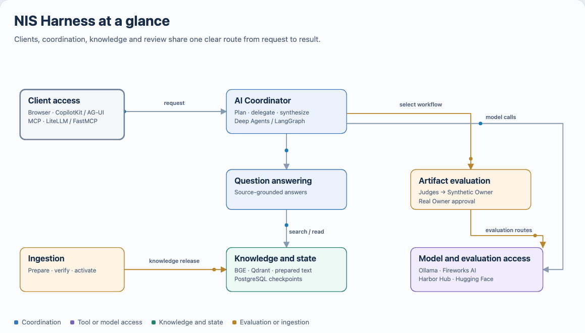

# Nora Intelligence System — AI Agent Harness

Nora is a self-hosted harness for answering questions from a private, versioned
document collection. It bounds retrieval and model calls, stores conversation
checkpoints in PostgreSQL, and runs ingestion separately so each knowledge release
can be verified before activation.

That separation lets a conversation keep its context while the corpus is updated
independently. The fictional Atlas walkthrough shows a question about release
blockers. A separate offline replay shows how reviewer feedback changes a draft
briefing and leaves the delivery decision with a human.

[Explore the architecture](https://nora-intelligence-system.com/architecture/) ·
[Follow the Atlas walkthrough](https://nora-intelligence-system.com/walkthroughs/?flow=request&step=current-question) ·
[Run the Atlas replay](https://nora-intelligence-system.com/reproduce/#atlas-replay)

## The architecture

The overview describes the accepted design. [Setup](docs/setup/README.md),
[validation](docs/evaluation/VALIDATION.md) and the dated
[deployment record](docs/setup/private-deployment/STATUS.md) own executable commands
and observed results; [the roadmap](docs/Plan.md) tracks the implementation sequence.



[Local browser version](docs/architecture/diagrams/system-at-a-glance.html) · [Architecture](docs/architecture/architecture-concept.md) · [Detailed diagrams](docs/architecture/diagrams/README.md)

The **Coordination Layer** groups the AI Coordinator and its interfaces. Deep
Agents and LangGraph support planning, specialist subagents and conversation
state. The CopilotKit browser UI reaches the coordinator through HTTP/AG-UI.
MCP clients use an **MCP Gateway (LiteLLM Proxy)** and the embedded **MCP Server
(FastMCP, `ask_nis`)**. The gateway provides MCP tool access; the coordinator owns
the task.

Retrieval MCP combines shared BGE embeddings, Qdrant and prepared full text.
PostgreSQL stores conversation checkpoints. Model selection is a separate
decision from delegating work: simple, general, reasoning and specialized routes
can use suitable model backends such as Ollama and Fireworks.

## Three workflows

| Workflow | Example | Result |
| --- | --- | --- |
| [Question answering](docs/agents/README.md) | Ask what still blocks the Atlas release, then follow up | A grounded answer and a continuing conversation |
| [Ingestion](docs/workflows/ingestion/README.md) | Add a revised guide alongside retained knowledge | A verified, explicitly activated knowledge release |
| [Artifact evaluation and revision](docs/workflows/artifact-review/README.md) | Review and improve the Atlas briefing | Feedback, revisions and a human acceptance decision |

In the target design, evaluation uses separate coordinator routes to Harbor Hub and Hugging Face.
Research into the role, domain and sources shapes versioned judge definitions.
Prepared Harbor tasks and datasets form the **NIS Judge Registry**. Judges give
feedback; a Synthetic Owner scores progress and recommends acceptance or
revision. Reaching the threshold sends the artifact to the Real Owner, who can
approve it or request another change. Lessons improve the next brief and judge
definitions.

## Project engineering

Upstream frameworks provide execution, persistence, protocols and models. The
table shows what Nora adds on top of those foundations.

| Project work | Foundation |
| --- | --- |
| Conversation ownership, context limits, bounded answers and shared client interfaces | Deep Agents, LangChain, LangGraph and FastMCP |
| Source preparation, document identity, hybrid ranking and bounded search/read | BGE, Qdrant and MCP |
| Provider adapters, capability selection and bounded fallback | LangChain model interfaces and inference backends |
| Browser integration, origin checks and server-side credential handling | Next.js, CopilotKit and AG-UI |
| Separate ingestion jobs, release verification and explicit activation | Python, Docker Compose and configured storage |
| Saved-review validation, exact-response decisions and revision records | The local artifact-review CLI |

[Decisions](docs/Decisions.md) explains the trade-offs.
[Requirements](docs/architecture/Requirements.md) states the behavior contracts, and
the [repository map](docs/README.md) points to their implementation owners.

### Engineering note: Keeping search and read on the same corpus release

An operator can activate a new knowledge release between an agent's search and
its follow-up read. If the original release becomes unavailable, silently using
the active release can mix evidence from two versions in one answer. Retrieval
now returns an error when an explicit pin is unavailable.
[Release resolution code](src/nora/retrieval.py#L167)

The regression test searches release A, activates release B, then reads with
the original pin. The read succeeds while A is available and returns an MCP
tool error when A is unavailable. Both releases contain the same document ID,
so a successful read would otherwise hide the fallback. An unpinned read still
succeeds against B. [Regression test](tests/test_jobs.py#L452)

## Try the review example

After [installing the source](docs/setup/README.md#install-for-development), run from
the repository root with a new output directory:

```bash
nora review-example --output .private/atlas-review-cycle
```

Expected result: two synthetic saved reviews, explicit decisions and a corrected
Atlas briefing. The example adds a missing prerequisite, rejects invented timing
and avoids duplicating an existing section. It makes no model or evaluation
service request.

## Evidence and further reading

| Evidence | What it establishes |
| --- | --- |
| [Source validation](docs/evaluation/VALIDATION.md) | Synthetic application contracts, framework integration, CLI and UI checks |
| [CPU embedding comparison](docs/evaluation/embeddings/RESULTS.md) | BGE throughput of 12.87 vs 2.73 excerpts/s for Qwen on 17 excerpts; a small historical CPU experiment |
| [Retrieval experiments](docs/evaluation/README.md) | Small-set ranking results and misses, with corpus and method boundaries preserved |
| [Private deployment record](docs/setup/private-deployment/STATUS.md) | Dated client and service checks |

These bounded results do not establish representative answer accuracy,
enterprise scale or general provider superiority. Retrieval relevance, answer
quality and execution correctness need separate evidence.

Use the [documentation index](docs/README.md) for the review route and the owning
workflow, setup and evaluation guides.

MIT licensed. Preserve [upstream notices](NOTICE.md) and the [template license](docs/templates/LICENSE).
