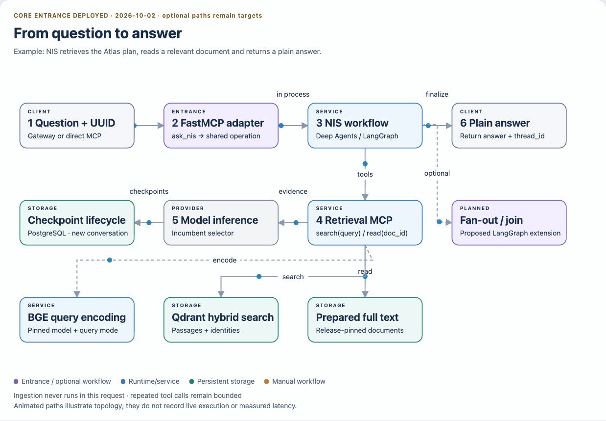
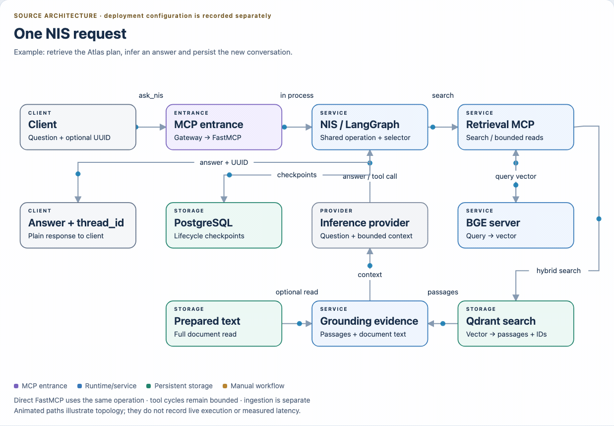
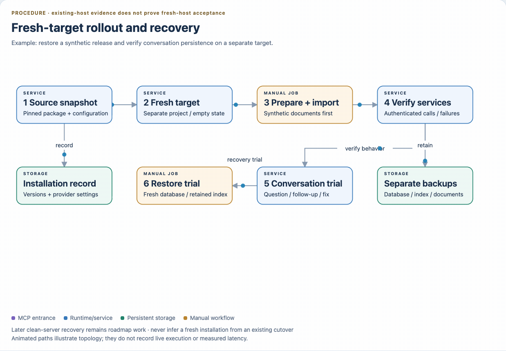

# Editable architecture diagrams

These views explain the accepted [one-assistant target](../../Decisions.md#selected-target-one-assistant-with-a-gateway-backed-mcp-entrance), current reference deployment and separate manual ingestion workflow. For example, the conversation views show a new topic UUID passing through the gateway or direct FastMCP entrance into NIS. The core entrance is implemented and running in the dated private candidate; optional diagram paths remain target views and [current source and deployment evidence](../../setup/containers/README.md#current-implementation) remains separate.

Maintain one HTML file with inline SVG as the editable source and one GIF derived from it. Open the HTML locally in a browser to use its interactive view; a repository HTML link displays source. Regenerate and visually inspect its GIF whenever the HTML changes. Separate SVG, Excalidraw and Mermaid files are not maintained.

## Refresh a GIF

From the repository root, with Playwright, Chromium and FFmpeg available:

```bash
node scripts/export_diagrams.cjs 01-system-architecture
```

Expected result: the matching GIF is regenerated from thirty frames of its actual HTML view. Omit the stem to export all pairs. `NODE_PATH` can point to an existing Playwright installation; `NIS_BROWSER_EXECUTABLE` and `NIS_FFMPEG` can select existing executables. These are operator-specific runtime paths, not repository defaults. Temporary capture frames are removed after export.

## System architecture


[Local browser version](01-system-architecture.html)

## Question to answer



[Local browser version](02-question-to-answer.html)

## Conceptual conversation


[Local browser version](conversation.html)

## Knowledge-update overview


[Local browser version](manual-ingestion.html)

## Request path



[Local browser version](architecture-request-path.html)

## Service inventory


[Local browser version](container-service-inventory.html)

## Selected rollout and later recovery



[Local browser version](private-rollout.html)

## Operator knowledge update


[Local browser version](ingestion-workflow.html)

The conversation path owns execution and PostgreSQL checkpoints. Ingestion owns independent job reports and starts only on an operator command. Retrieval and batch embedding share BGE; the index and prepared documents advance together. The dedicated GCS deployment and local retained-corpus route remain distinct.

Sources: [architecture](../Architecture%20Concept.md), [assistant](../../agents/README.md), [service inventory](../../setup/containers/README.md), [manual workflow](../../workflows/ingestion/README.md) and [roadmap](../../Plan.md).
