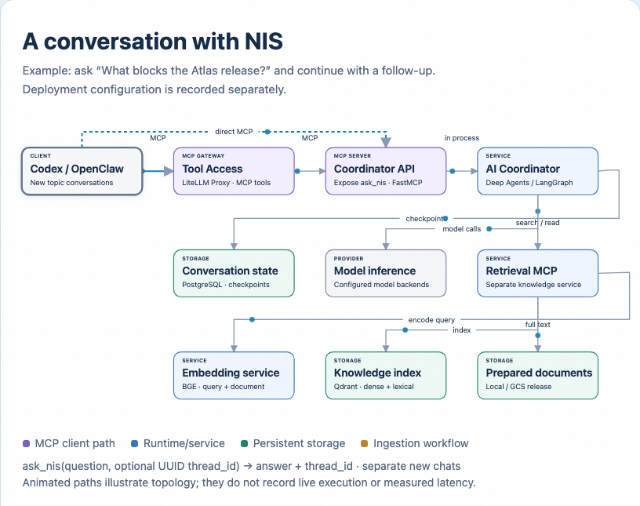

# NIS AI Coordinator

[Home](../../README.md) · [Architecture](../architecture/architecture-concept.md) · [Coordination](../setup/containers/coordination.md)

The AI Coordinator plans work, selects a workflow, delegates bounded subagents,
chooses model routes and combines their results. Deep Agents/LangGraph provides
the execution foundation inside the Coordination service. For example, answer
an Atlas release question from saved sources, then review its handover briefing
through the [artifact workflow](../workflows/artifact-review/README.md).

The [architecture](../architecture/architecture-concept.md) owns this accepted
design. The question-answering interfaces and bounds below describe the existing
runtime. Research and interview analysis use topic conversations rather than
separately selectable roles.

[Local browser version](../architecture/diagrams/architecture-request-path.html)

## Runtime boundary

The Coordination service contains the Deep Agents runtime, model selector, tools and
conversation lifecycle. It uses shared Retrieval MCP for search/read and
PostgreSQL for checkpoints. The Browser UI uses CopilotKit/AG-UI over HTTP;
MCP clients use the FastMCP `ask_nis(question, thread_id=None)` tool, directly or
through the LiteLLM Proxy MCP Gateway. Both reach the same operation.

A missing UUID starts a new topic; the returned UUID continues it. Checkpoints use `assistant:<UUID>`. Current assistant history survives normal restart. Legacy role history is retained in storage but is not exposed or migrated into this interface.

[Local browser version](../architecture/diagrams/conversation.html)

## Answer behavior

Search for relevant saved material, read the matching source when needed, then give a concise answer or clarification. State missing evidence and distinguish a dated export from present state. Normal answers omit citation cards and internal IDs; requested source titles/headings can be named in prose.

### Retrieval and model bounds

**Grounding** is the automatic source lookup before answer generation. It shares
the turn's three-call retrieval budget with model-requested search and reads.
The initial search leaves at most two calls. Scoped
preparation-preservation questions and related follow-ups also read one matching
returned document ID at offset zero before generation, leaving at most one call.
If no candidate is found, the two remaining calls stay available. Candidate
selection permits inspection; retrieved content and metadata establish the title
and supported facts. Counts reset each turn. Excess requests return tool errors
without executing retrieval.

Four logical model calls bound a turn. A requested numeric word cap can use one
no-tool repair within that allowance. The request-only `HumanMessage` named
`nora_answer_repair` ends the repair model request, preserving the original
system message and retrieved evidence/draft. It never enters graph state or
checkpoints. The selector ignores it when identifying the user question;
context bounds count its characters without counting it as a genuine user turn.

### Scoped preparation checks

The [answer guidance](../../src/nora/assistant.py) and
[PREPARATION_GROUPS and preparation_scope](../../src/nora/agent.py) define a narrow
English-language check for explicit NIS preparation-preservation questions and
related follow-ups.
Its six coverage groups are:

1. Deterministic preparation without summaries or meaning rewrites.
2. Originals.
3. Headings and substantive text.
4. Source identity and metadata.
5. Chunk identities, hashes and offsets.
6. Model configuration with vectors.

These are topics to check against retrieved evidence, not a promise that every
source version preserves every artifact. The current
[processing contract](../workflows/ingestion/README.md#processing-contract)
retains chunk IDs and model configuration with vectors, but does not persist
chunk offsets or individual chunk-content hashes. State unsupported details as
gaps rather than borrowing an older source's artifact inventory.

For scoped preparation-preservation repairs, recheck all supported requested
groups, including fields already present in the draft, and explicitly associate
model configuration with vectors. The existing field-matching rules and call
allowance stay the same. Source-heading attribution compares case and collapsed
Unicode whitespace without changing answer text or relaxing required facts.

For example, a question explicitly naming the Manual ingestion guide and asking about an SLA uses the same targeted search and returned-ID read when a candidate is available. This source-selection scope uses only the current question and stays separate from the six-field preparation check. Generic ingestion questions keep their ordinary search route. Automatic search/read calls share the existing retrieval budget.

Preparation follow-ups restate supported preservation fields and requested
derived artifacts named in retrieved passages, without claiming an exhaustive
inventory. Missing-information statements describe the passages inspected. If
the requested guide was not obtained, say so; do not attribute a broader excerpt
to it or generalize that excerpt to deployment knowledge.

## Evaluation

Check target selection, evidence, omissions, corrections, conversation
continuation and explicit answer limits. The preparation source correction
passed six isolated production-model cases. The 2026-10-13 isolated check passed
two fresh preparation questions and one follow-up on gpt-oss:20b. These bounded
checks do not establish general instruction-following reliability.

[Deployment status](../setup/private-deployment/STATUS.md) owns live
Codex/OpenClaw outcomes; [evaluation](../evaluation/README.md) owns
representative quality work. Local acceptance and deployment remain separate.
