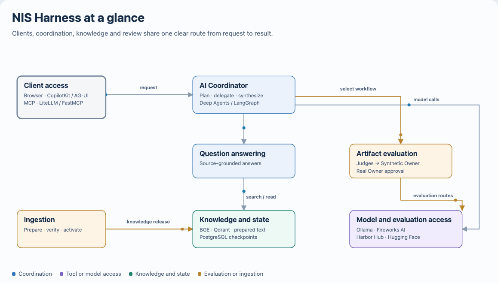
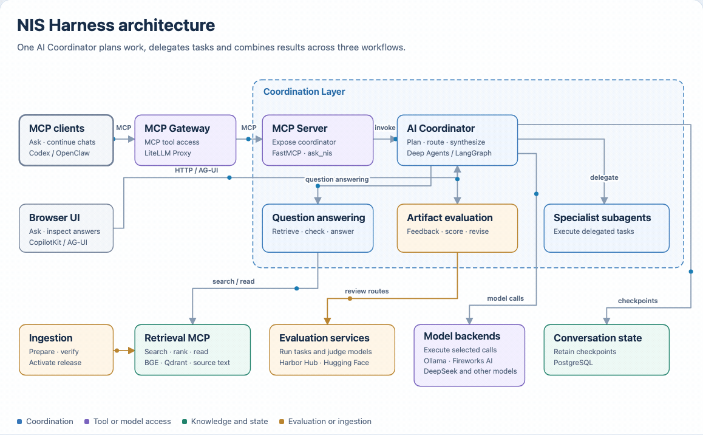
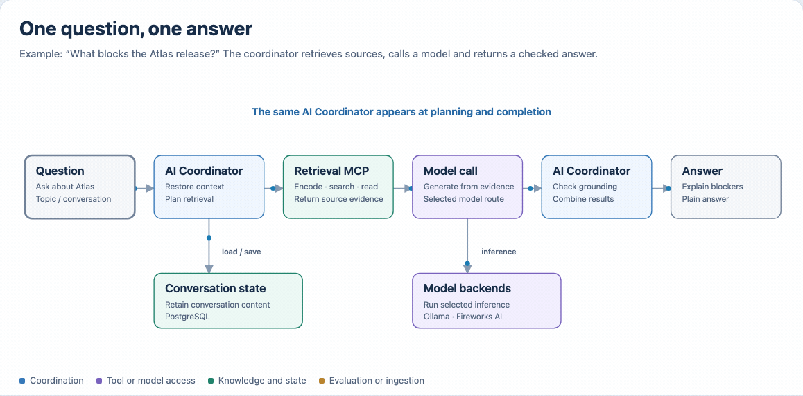
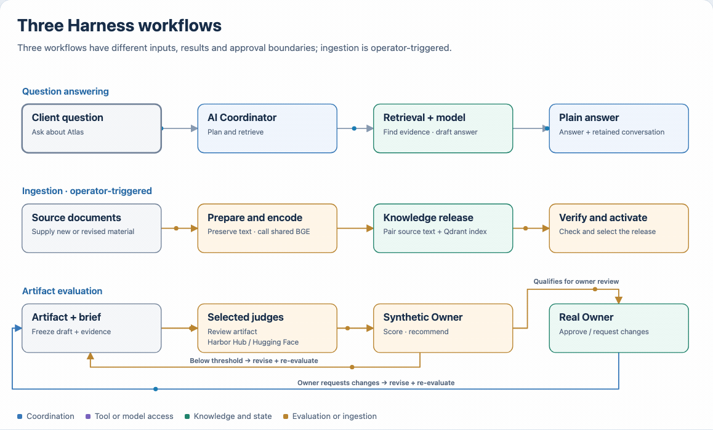
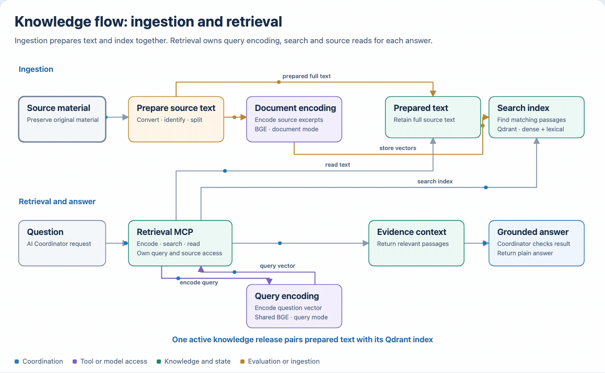
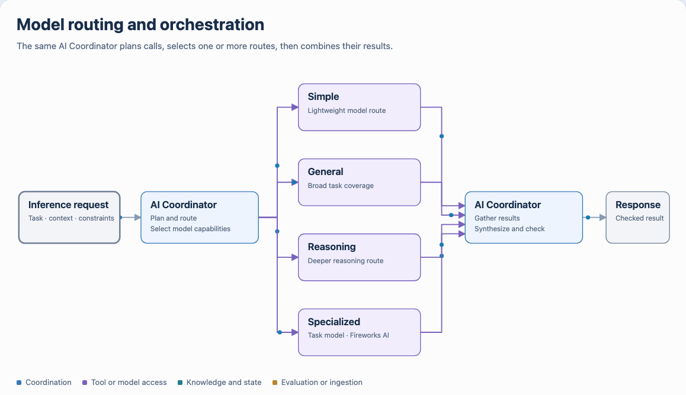
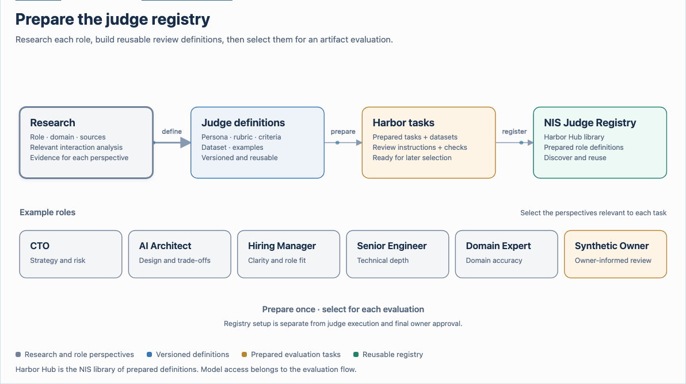
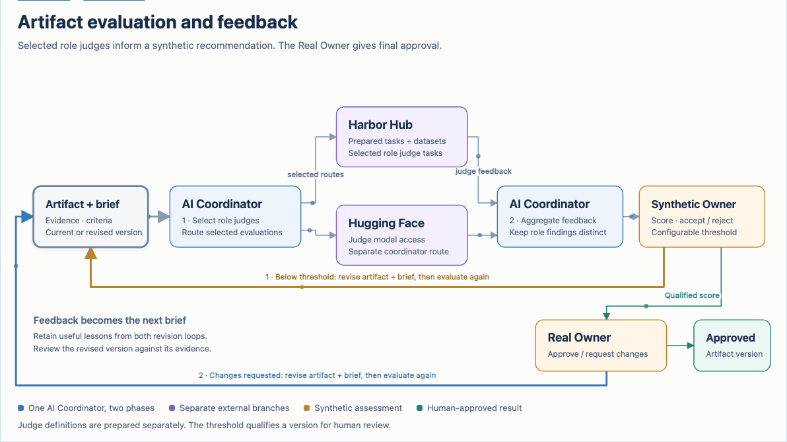

# Architecture and workflow diagrams

Start with the system view, follow the knowledge flow, then explore model routing
and review. These diagrams explain the Harness design. The dated
[deployment record](../../setup/private-deployment/STATUS.md#configuration-reference--2026-10-21)
owns installation state.

## System architecture

The compact view shows the main responsibilities at reading width.



[Local browser version](system-at-a-glance.html)

The detailed view separates the Coordination Layer, MCP tool access, model
backends, retrieval, evaluation and conversation state.



[Local browser version](01-system-architecture.html)

## Request path

Follow one question through retrieval, model inference and conversation state.



[Local browser version](architecture-request-path.html)

## Harness workflows

Compare question answering, knowledge ingestion and artifact evaluation and revision.
Ingestion and artifact review run separately from conversations.



[Local browser version](harness-workflows.html)

## Knowledge flow

Ingestion prepares full text and a Qdrant index. Retrieval uses shared BGE to
encode the question, then searches and reads from the same knowledge release.



[Local browser version](02-question-to-answer.html)

## Model routing and orchestration

The AI Coordinator selects model capabilities and combines the returned results.
Model selection is a different decision from choosing a workflow or subagent.



[Local browser version](model-routing.html)

## Judges and feedback

Prepare reusable role definitions before reviewing an artifact.



[Local browser version](judge-registry.html)

The review uses a Synthetic Owner score to decide when a version is ready for
Real Owner review. Both can return the material for another pass. The
[workflow guide](../../workflows/artifact-review/README.md) owns criteria,
versioning and the Atlas example.



[Local browser version](artifact-review-flow.html)

## Detailed views

### Conceptual conversation

Client paths and conversation continuity. [GIF preview](conversation.gif) · [Local browser version](conversation.html)

### Knowledge-update overview

The four ingestion jobs and activation boundary. [GIF preview](manual-ingestion.gif) · [Local browser version](manual-ingestion.html)

### Service inventory

Source container responsibilities and storage. [GIF preview](container-service-inventory.gif) · [Local browser version](container-service-inventory.html)

### Selected rollout and later recovery

A reference procedure for a separate target. [GIF preview](private-rollout.gif) · [Local browser version](private-rollout.html)

### Operator knowledge update

The local-pin activation example. [GIF preview](ingestion-workflow.gif) · [Local browser version](ingestion-workflow.html)

### Historical CPU embedding comparison

Document throughput and query latency on one small CPU workload. [GIF preview](embedding-cpu-comparison.gif) · [Local browser version](embedding-cpu-comparison.html)

### Embedding comparison method

Shared inputs, pinned models, repeated CPU trials and the evidence boundary. [GIF preview](embedding-comparison-method.gif) · [Local browser version](embedding-comparison-method.html)

### Public source release

The explicit allowlist, clean snapshot and separate public repository. [GIF preview](public-source-release.gif) · [Local browser version](public-source-release.html)

## Refresh a GIF

Maintain one editable HTML file with inline SVG and one matching GIF. A repository
HTML link displays source; open the file locally in a browser for interaction.

From the repository root, with Playwright, Chromium and FFmpeg available:

```bash
pnpm exec node scripts/export_diagrams.cjs 01-system-architecture
```

Expected result: a matching animated GIF derived from that HTML. Omit the stem to
export all pairs. `NODE_PATH`, `NIS_BROWSER_EXECUTABLE` and `NIS_FFMPEG` may select
existing dependencies. Temporary frame directories are separate and removed.
Regenerate and visually inspect previews after changing HTML. Separate SVG,
Excalidraw and Mermaid files are not maintained.

Sources: [architecture](../architecture-concept.md), [AI coordinator](../../agents/README.md), [services](../../setup/containers/README.md), [ingestion](../../workflows/ingestion/README.md) and [roadmap](../../Plan.md).
