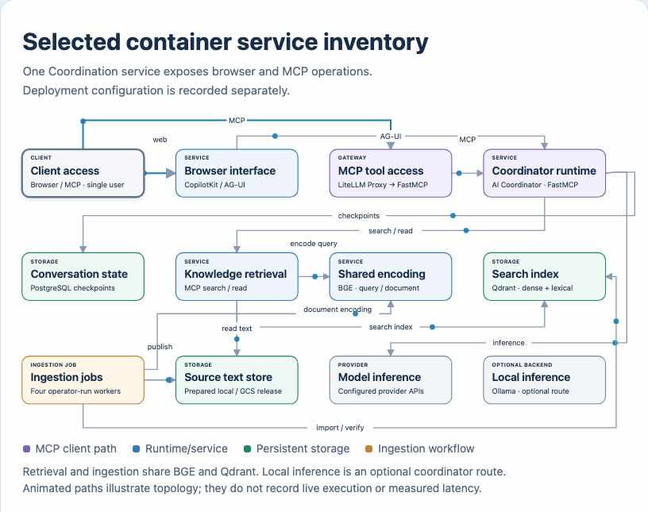

# Application configuration

[Setup](README.md) · [Settings source](../../src/nora/config.py) · [Compose](../../compose.yaml)

For example, a host can change its answer provider and collection through environment variables while running the same application package. NIS reads settings when a service or CLI command starts; importing a module does not load weights, credentials or clients.

[Local browser version](../architecture/diagrams/container-service-inventory.html)

These settings configure the Coordination service, shared Retrieval and manual
ingestion jobs. [Coordination](containers/coordination.md#client-contract) owns
the question/optional-UUID contract. [Deployment status](private-deployment/STATUS.md)
records running images and acceptance; [architecture](../architecture/architecture-concept.md)
owns the accepted workflow design.

## Paths and endpoints

| Variable | Default outside Compose | Purpose |
| --- | --- | --- |
| `NORA_COORDINATION_URL` | `http://coordination:8000` in Compose | UI server target for the Coordination service |
| `NORA_DATA_DIR` | `.runtime/data` | Prepared-data selection; Compose sets `/data/current` for its active release |
| `NORA_STATE_DIR` | `.runtime/state` | SQLite daily request counter |
| `NORA_MODEL_PATH` | `.runtime/models/bge` | Verified local BGE cache |
| `NORA_COLLECTION` | `nora_prepared_bge_v1` | Explicit Qdrant collection (fallback when no active release names one) |
| `NORA_QDRANT_URL` | `http://localhost:6333` | Index endpoint |
| `NORA_RETRIEVAL_URL` | `http://localhost:8001/mcp` | MCP endpoint |
| `NORA_BGE_URL` | `http://localhost:8002` | Shared BGE HTTP service |
| `NORA_BGE_TIMEOUT` | `60` | Batch embedding request timeout (seconds) |
| `NORA_BGE_MAX_BATCH_SIZE` | `64` | Maximum texts per `/encode` request |
| `NORA_OLLAMA_URL` | `https://ollama.com` | Answer provider |
| `NORA_OLLAMA_MODEL` | `gpt-oss:20b` | Configurable model example; availability depends on the provider |
| `NORA_RELEASES_ROOT` | `.runtime/releases` | Parent directory for versioned release bundles and the `current` symlink/pointer |
| `NORA_GCS_MANIFEST` | Unset | Optional local manifest for generation-pinned GCS reads |
| `NORA_GCS_POINTER` | Unset | Authoritative `gs://bucket/object` cloud activation pointer consumed by Retrieval |
| `NORA_GCS_PROJECT` | Unset | GCP project for the cloud storage client |
| `NORA_GCS_BUCKET` | Unset | Bucket used for both release publication and the activation pointer (must match the pointer bucket) |
| `NORA_GCS_PREFIX` | Unset | Prefix under which release documents and manifests are published |
| `NORA_GCS_PUBLISHER_CREDENTIALS_FILE` | Unset | Explicit keyless publisher ADC file; alternative to service-account impersonation below |
| `NORA_GCS_PUBLISHER_SERVICE_ACCOUNT` | Unset | Publisher service account to impersonate when no publisher credential file is selected |
| `NORA_MCP_ALLOWED_HOSTS` | `localhost:*,127.0.0.1:*,retrieval:*` | HTTP Host values accepted by MCP |

The Docker launcher takes an explicit releases-root argument:
`scripts/knowledge-update <source-dir> <releases-root> [<collection>]`.
In local mode it writes versioned bundles and advances `current` under that
root. Match the mounted root to Retrieval's selection; `NORA_DATA_DIR` does not
choose the launcher's output directory. The host CLI also requires a `releases`
positional argument, but its
[tokenizer handoff remains incomplete](../workflows/ingestion/README.md#operator-commands).
A literal release pin needs an explicit deployment change; see
[activation](../workflows/ingestion/README.md#backups-and-activation).

Compose sets container paths and service DNS names. Root Compose publishes UI
port 8080 and Gateway port 4000 on loopback when those services run. Retrieval,
BGE, Coordination and both databases remain internal; direct host access needs
an explicit overlay or proxy. See the
[service boundary reference](containers/README.md#current-implementation).

## Model routing

| Variable | Default | Purpose |
| --- | --- | --- |
| `NORA_ASSISTANT_MODELS` | built-in defaults | JSON array of candidate models for the assistant |
| `NORA_FIREWORKS_URL` | `https://api.fireworks.ai/inference/v1` | Fireworks OpenAI-compatible endpoint |
| `NORA_FIREWORKS_MODEL` | `accounts/fireworks/models/kimi-k3` | Example model slug |
| `NORA_SELECTOR_COST_WEIGHT` | `1.0` | Relative cost weight |
| `NORA_SELECTOR_LATENCY_WEIGHT` | `1.0` | Relative latency weight |
| `NORA_SELECTOR_LOG` | unset | Optional hashed-query decision log |

Compose forwards `NORA_ASSISTANT_MODELS` and selector weights. The inventory uses
conservative quality/cost/latency assumptions rather than measured values.
[Model inventory reference](model-routing.md#model-inventory-reference) owns
candidate fields, override parsing, selection and fallback. There is no role
selection setting.

## Credentials and PostgreSQL

Use `NORA_<NAME>` or `NORA_<NAME>_FILE`, with one source per credential. Names
are `QDRANT_KEY`, `MCP_TOKEN`, `INTERNAL_TOKEN`, `POSTGRES_PASSWORD`, `OLLAMA_TOKEN`,
`BGE_TOKEN` and optional `FIREWORKS_TOKEN`. Service credentials are required.
An empty Ollama token is valid for a local endpoint; an empty Fireworks token
keeps that provider out of selection. Errors identify settings without printing
their values.

`nora init` creates owner-only files under `.runtime/secrets`, including Gateway
and BGE, but omits Fireworks. Compose still requires its mounted file; when the
provider is disabled, create an empty private file without replacing an existing
credential, as shown in [setup](README.md#run-the-application). An absent mount
source fails before model selection. PostgreSQL's wrapper reads its file before
the official entrypoint changes user. UI credentials are read on the server at
request time, never during browser compilation.

PostgreSQL uses `NORA_POSTGRES_HOST`, `NORA_POSTGRES_PORT`, `NORA_POSTGRES_DB` and `NORA_POSTGRES_USER`; defaults are `localhost`, `5432`, `nora`, `nora`. The official async LangGraph checkpointer initializes its schema at service startup. Credentials stay outside database URLs in source files.

## Request bounds

| Variable | Default |
| --- | ---: |
| `NORA_DAILY_LIMIT` | 60 accepted requests per UTC day |
| `NORA_CONCURRENCY` | 1 active run in the Coordination process |
| `NORA_REQUEST_TIMEOUT` | 180 seconds |
| `NORA_TOOL_TIMEOUT` | 45 seconds |
| `NORA_QUESTION_LIMIT` | 4,000 characters |
| `NORA_HISTORY_TURNS` | 4 user turns in model context |
| `NORA_KNOWLEDGE_CALL_LIMIT` | 3 searches/reads per run, including initial search |

The counter is atomic across local SQLite connections. It counts requests, including failed attempts, rather than tokens or provider calls. A model retry and optional routing fallback can make multiple inference calls.

The existing `nora_thread_ownership` table retains stored owner records. `/ask`, `/agent` and `/history/{thread_id}` use assistant ownership and reject UUIDs already belonging to legacy roles. Checkpoints use `assistant:<UUID>` without a raw legacy fallback. Old role records are retained but not exposed or migrated. Distributed locks and provider spending caps are not implemented.

HTTP bodies are limited to 70 KB before Coordination JSON parsing. The model view is bounded to 48,000 characters, with old turns removed as groups and tool/result pairs retained. Checkpoints keep the complete conversation.

## Optional routing and GCS

[Model selection](model-routing.md) owns the assistant selector and its limitations.

For local filesystem mode, Retrieval reads full documents from the active release directory under `NORA_RELEASES_ROOT`.

For GCS mode, set `NORA_GCS_POINTER` to an authoritative `gs://bucket/object` URL, `NORA_GCS_BUCKET` to the bucket used for both release publication and the pointer, and `NORA_GCS_PREFIX` to the release-artifact prefix. Activation publishes prepared documents plus a generation-pinned manifest and atomically updates the pointer with a compare-and-swap generation precondition; Retrieval reads the pointer on each request to discover the active manifest and documents. The storage client uses normal Application Default Credentials. Every document read verifies the content hash against its SHA-256 ID. `NORA_GCS_MANIFEST` is a legacy local manifest path used only for explicit local reads; the cloud pointer is the production activation mechanism.

The publisher identity is separate from Retrieval's ordinary reader identity.
Set `NORA_GCS_PUBLISHER_CREDENTIALS_FILE` to an ADC file that uses keyless
federation or service-account impersonation. Its publisher identity needs
permission to upload release objects and update the pointer with a generation
precondition. Long-lived service-account key files are rejected. If a file is
selected, missing or unreadable credentials fail before upload side effects.

Alternatively, set `NORA_GCS_PUBLISHER_SERVICE_ACCOUNT` without a publisher file.
The activation client uses its available source ADC to impersonate that account;
the source identity needs permission to impersonate it. GCS activation rejects
an absent publisher configuration. Retrieval continues to use reader ADC and
does not gain publisher permissions from either setting.

Compose passes `NORA_GCS_POINTER` and `NORA_GCS_PROJECT` to Retrieval and the `admin` service. These values select storage, not a credential identity. GCP deployment must supply and verify keyless Application Default Credentials separately for the runtime reader and the authorized publisher; no publisher credentials are baked into source.

The four-container `scripts/knowledge-update` launcher chooses the activation
mode from its environment. In local mode it atomically replaces `current` under
the supplied releases root. In GCS mode it runs the four jobs, then invokes
`nora activate` inside `admin`, using either the read-only publisher file mounted
at `/run/secrets/gcs-publisher` or the configured impersonation identity. It
updates the cloud pointer, then the local `current` symlink and history; these
are separate writes. Keep the pointer and publication bucket aligned.

The UI accepts its loopback origin and the loopback 8080 origins by default. Set `NORA_UI_ALLOWED_ORIGINS` to a comma-separated list that includes an intended additional origin, including its HTTPS scheme and port. Compose forwards this variable to the UI and `NORA_MCP_ALLOWED_HOSTS` to Retrieval; both can be set in `.env`. [Tailscale setup](README.md#private-access-with-tailscale) uses these settings for the selected private access path. They configure origin/host checks, not user login or tenant isolation.
