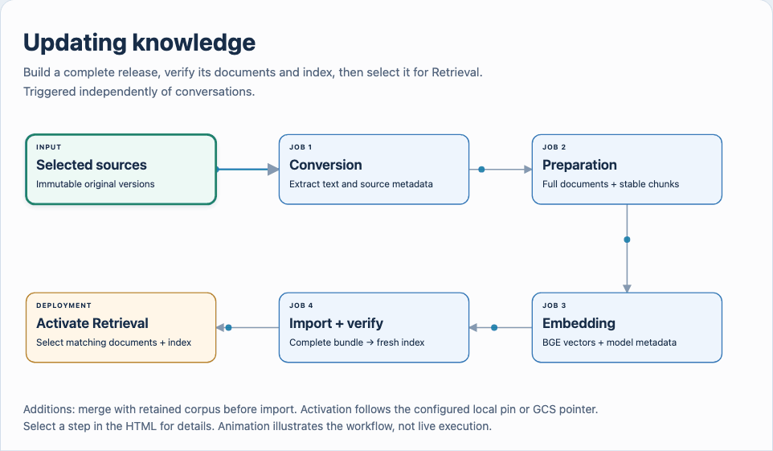

# Ingestion jobs

[Services](README.md) · [Ingestion contracts](../../workflows/ingestion/README.md) · [Run an update](../../workflows/ingestion/knowledge-base-update-checklist.md)

Package an operator-run ingestion batch as temporary jobs. For example,
conversion reads selected notes, preparation and embedding produce a complete
bundle, and import verifies a new Qdrant collection before activation.

[Local browser version](../../architecture/diagrams/manual-ingestion.html)

## Packaging

Root Compose defines four job services under the `ingestion` profile. Each has
its own entrypoint and completed input/output contract, then exits. The
[accepted decision](../../Decisions.md#ingestion-and-state)
records this boundary; the [ingestion workflow](../../workflows/ingestion/README.md#ingestion-stages)
owns stage ordering and artifact semantics.

| Service | Image | Entrypoint | Storage and service access |
| --- | --- | --- | --- |
| `job-convert` | `nora-conversion:local` with Docling extra | `nora job convert` | Originals read only; extracted artifacts persisted |
| `job-prepare` | Shared backend | `nora job prepare` | Extraction in; full documents and chunks out |
| `job-embed` | Shared backend | `nora job embed` | Prepared chunks in; shared BGE document encoding; vectors/reports out |
| `job-import` | Shared backend | `nora job import` | Complete bundle in; writes and independently verifies Qdrant |
| `admin` activation step | Shared backend | `nora activate` | In GCS mode, publisher access and retained local release storage |

Use the deployment's effective image overrides rather than assuming source defaults are its running image. See [Compose source](../../../compose.yaml) and the installation's private operating record.

## Mounts and ownership

- Mount selected originals read only into conversion.
- Persist extraction, prepared full documents, chunks, vectors and job reports outside worker lifetimes. Local release storage and Qdrant are distinct; the full text is not reconstructed from the index.
- Keep model caches and PostgreSQL volumes separate from source/release storage. Ingestion owns job reports; conversation checkpoints do not own or schedule ingestion.
- Give embedding access to shared BGE and bound batch load; import owns Qdrant writes.
- When GCS publication uses `NORA_GCS_PUBLISHER_CREDENTIALS_FILE`, mount it read only into `admin` only. Retrieval has reader access; job workers do not receive the publisher file. The alternative publisher service-account impersonation route still requires a separately configured keyless identity.

## Launchers and deployment selection

Use `scripts/knowledge-update` to run the four job containers. It checks completed
artifacts before activation and creates a complete release from the selected
input. Additions therefore need separate jobs and `nora assemble` to retain the
base corpus. Assembly is an operator CLI step, not a fifth job service.

The host `nora knowledge-update` wrapper uses a pinned local tokenizer for
preparation and the shared BGE HTTP client for embedding. It needs its own
verified model cache, Python extras, reachable endpoints and credentials; the
[workflow guide](../../workflows/ingestion/README.md#operator-commands) owns
those prerequisites. Individual `nora job` entrypoints remain separate from
the wrapper. Source repair does not update installed images or running services.

Without `NORA_GCS_POINTER`, the Docker launcher selects the release through local `current`. With it, the launcher uses `admin` to publish and conditionally advance the cloud pointer. A literal local-directory pin needs a separate deployment overlay/recreation; follow the [operator checklist](../../workflows/ingestion/knowledge-base-update-checklist.md#4-activate-retrieval).

Set `NORA_COMPOSE_PROJECT` to the application's existing Compose project, along
with its complete file set, mounted paths and service configuration. The launcher
otherwise defaults to `nora-ingestion-e2e`, which has a separate Qdrant volume;
the fresh installation guide explicitly uses `nora` for both jobs and services.
Preserve current repair overlays during deployment operations. Questions and
folder changes never trigger a batch. GCS activation requires the installation's
publisher/IAM configuration; source examples do not change deployment state.

`nora cache-model` manages the pinned embedding model cache. The split job entrypoints above define this workflow.
