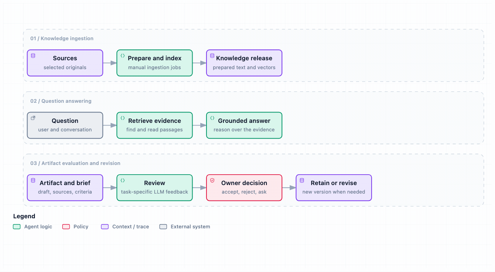

# Source and container validation

[Evaluation](README.md) · [Setup](../setup/README.md) · [Roadmap](../Plan.md)

This record separates local source checks, synthetic examples and the earlier
isolated ARM Linux Compose trial. Synthetic fixtures contain no private corpus
material. Each dated section states what its checks establish.

[Local browser version](../architecture/diagrams/harness-workflows.html)

## Reader-facing documentation pass — checked 2026-10-21

The README now names Michael's application work before a compact system view.
The detailed architecture remains linked; the Atlas guide states the local
saved-response boundary before describing external review routes. The roadmap
and this record distinguish current source checks from earlier dated results.

Local checks pass for 53 public documents, 508 local links and assets, 14
HTML/GIF diagram pairs and the 200-file source manifest. The new GIF was
exported from its HTML and inspected. Headless browser checks at 800 and 390
pixels found no page errors or page-level horizontal overflow and confirmed
that selecting a node reveals its details. At mobile width the diagram scrolls
inside its panel to keep labels readable. These checks do not test live services.

## Earlier documentation and diagram consistency — checked 2026-10-21

This documentation-only pass aligns processing contracts and source/deployment
descriptions, adds the missing question-answering workflow row, removes the
invented design concept and reorganizes the diagram catalog into three main
views plus technical detail. Nine changed HTML views have matching regenerated
GIFs; smaller workflow labels and legends are larger within the existing style.

At that pass, local links, ten HTML/GIF pairs and the 192-file source manifest
passed. The two standalone workflow views passed deterministic checks and
browser containment at four desktop sizes, with light/dark captures. A separate
read-only review found remaining old tooltip and activation claims; those were
corrected in the same pass. Application code, live services and corpus data were
unchanged. The dated
configuration reference reconciles saved operating guidance and is not a fresh
live deployment check.

## Earlier whole-project source review — checked 2026-10-21

Two improvement passes reviewed documentation, architecture, workflows, code,
setup, tests, the embedded UI and public/private source boundaries.

| Finding | Change and evidence |
| --- | --- |
| The main entry point hid the engineering story | README now leads with the problem, contribution, architecture, workflows, trade-offs and evidence |
| The roadmap covered only artifact review | Plan.md again covers the whole harness and keeps separate acceptance work visible |
| Evidence and visual rules were scattered | Evaluation has one index, historical findings retain their dated record, and DESIGN.md records existing visual rules |
| Diagram export assumed one viewer implementation | The exporter supports both maintained HTML formats; both updated GIFs were regenerated from their HTML |
| A valid large review could produce unreadable revision input | Compact feedback and an explicit output bound are covered by two regression tests |
| Workspace reference copies blocked public-doc inventory | Exact existing skill-copy paths are classified explicitly; unclassified new documents still fail inventory checks |

**Results from that pass:** 323 Python tests and 11 subtests passed; eight tests skipped.
Lint and formatting, five UI server-boundary tests, TypeScript, the production
build, shell syntax, local links, ten HTML/GIF pairs and the 192-file source
release manifest pass. Three upstream dependency deprecation warnings remain.
External documentation URLs were inventoried rather than fetched by linkcheck.
A fresh-context, read-only review of all 23 changed files found no blocking
defects. It inspected source and documentation; the checks above supply execution
evidence. The primary checkout's staged entries were preserved exactly.

The browser acceptance script passes ten scenarios against synthetic services,
including follow-up, history restoration, mobile layout and an unavailable
backend without losing the selected conversation. Screenshots of these states
were inspected. All ten diagrams were inspected in the browser; the two changed
workflow viewers also passed automated checks at four desktop sizes with light
and dark screenshots. Private receipts are excluded from publication.

This pass does not add real-provider quality measurements, representative
retrieval results or deployment acceptance. Those remain separately scoped in
the roadmap. The earlier workflow and deployment records below retain their
original counts and boundaries.

## Artifact-review workflow — checked 2026-10-21

The local workflow adds saved-response validation, explicit owner-decision and
revision recording, and a two-version synthetic Atlas example. It does not call
an inference provider, edit an artifact automatically, or change conversations,
corpus data, services or refresh automation.

- 321 Python tests pass, eight skip, and 11 subtests pass. New review tests cover
  invalid identity/quotes/content, null failure scores, duplicate feedback,
  unknown-fact ownership, input limits, interrupted state, stale decisions,
  no-change outcomes and linked revisions. Existing runtime contracts also pass.
- Decisions bind to the exact saved response hash. Regression tests reject
  decisions reused for another review of the same packet, decisions without
  that hash, edited feedback and changed saved responses. Revision recording
  checks receipt hashes and feedback against the original response.
- All three review CLI commands were exercised from this checkout. The example
  retains the missing-prerequisite correction, rejects an invented duration and
  avoids duplicating an existing question. Its reviews and owner decisions are
  scripted fixtures, not a live judge or measured quality improvement.
- Both workflow diagrams pass nine deterministic showcase checks with no errors
  or warnings. Automated browser evidence passes at four desktop sizes; light
  and dark screenshots were visually inspected. Matching GIF previews come from
  the actual delivered HTML. Private browser receipts stay outside publication.
- Lint/format and the 191-file source-release check pass. A clean allowlisted
  source snapshot passes 52-document link checking, ten HTML/GIF pair checks,
  source scanning and 42 focused review/CLI tests. In the primary checkout,
  link/diagram inventory remains blocked by the existing unlisted skills tree.

The separate website source has a local Workflows page using the same diagram
bytes; its own context records site-specific checks. Neither source change is a
publication or deployment. Historical validation below retains its original scope.

## Checked locally

- Python contract tests cover deterministic preparation, exclusions, document hashes, generation-pinned GCS reads through a double, incompatible and corrupted imports, Qdrant round trips, atomic request accounting, routing failures and model-cache validation.
- The real Deep Agents/LangGraph and AG-UI adapters run with a deterministic model double and an in-memory checkpointer. Tests cover grounding, bounded follow-up context, history, request limits and recovery after retrieval failure.
- The real MCP server handles initialization, tool discovery, search/read, authentication and invalid requests.
- The separate real-BGE smoke test downloads the pinned public model, verifies its cache receipt, encodes three fictional documents, imports an embedded Qdrant index and uses the MCP SDK over loopback HTTP. Each of three labeled questions ranks its expected document first: Hit@1, Hit@5 and MRR@5 are 1.0.
- The retained Google Cloud foundation tests exercise configuration, offline plans and mocked resource checks; they create no cloud resources.
- The UI has server-boundary tests, a TypeScript check and a production build without a credential file. Browser interaction is checked against a synthetic backend.
- Documentation links, anchors, diagram inventory, HTML/GIF pairs and source-release paths are checked. Python wheel/source distributions and the explicit public source archive are inspected for their intended contents.

The source-refactor pass completed 80 Python tests, 11 cloud-planning subtests and three UI tests, including validation from a freshly extracted source archive and installed wheel. The public tests and [smoke script](../scripts/synthetic_smoke.py) are the reproduction entrypoints.

The subsequent publication cleanup repeated the source checks, built the Python distributions in an isolated environment, and passed UI tests, type checking and the production build on CI's Node.js 22.22.0. Visual review covered all six editable Excalidraw drawings and nine Mermaid diagrams. Four target drawings received corrected text spacing and matching browser-rendered SVG previews; the service inventory diagram was rearranged to separate the BGE connection labels. These documentation changes do not implement or deploy the selected target architecture.

## Isolated container trial

The separate VM task records the earlier five-service 0.1.0 baseline as already deployed, with three example documents, Atlas answers/follow-up and history after browser refresh. Its deployed source archive SHA-256 is `40d1d121e173523492f50b70096fb2cf1ad08400b6b8107d015199503e98a8dc`. That is a recorded result from that task, not an independent host probe here; the new candidate in this checkout is distinct and not deployed. The next deployment is a controlled upgrade of that existing baseline, not a new VM or initial deployment. VM reboot recovery, full-corpus operation and the new architecture were not proven by browser refresh.

The trial built both application images and started the five default services on Linux aarch64 under Colima, with four CPUs and about 8 GiB RAM. Containers used Python 3.12.12, Node.js 22.22.0, the pinned PostgreSQL/Qdrant images and Ollama Cloud `gpt-oss:20b`. All 18 installed backend modules matched the reviewed source. The container dependency check found no broken requirements.

| Check | Observed result |
| --- | --- |
| Preparation and server import | Three fictional documents and three points imported; document payloads and all three vector samples verified |
| Question | Correct Atlas release date, October 12, 2026, and owner, Jordan |
| Same-conversation follow-up | Correct payment-service load test and rollback prerequisites |
| Missing evidence | Correctly stated that Cedar promises no resolution-time guarantee |
| PostgreSQL and Coordination restart | All four existing message IDs, roles and contents preserved exactly |
| Backup and fresh storage | Custom-format dump restored into a separate PostgreSQL instance with a new volume; the same four messages matched exactly |
| Post-restore follow-up | Correct owner and date; conversation grew to six messages |
| Containerized browser UI | All six messages returned through the UI history proxy; the final restored turn rendered after reload; mobile width and new-conversation checks passed without browser errors |
| Access configuration | Compose forwarded a configured UI origin and MCP hostname; accepted requests returned 200, unconfigured values returned 403/421, and missing MCP credentials returned 401 |

These are four application question requests, each with one recorded knowledge call. They are not provider billing or token measurements. The trial uses generated service credentials and isolated volumes; the existing deployment was not changed.

The first database image pull needed one retry after a registry connection failure. A host-only temporary path was then moved under an existing Colima-shared directory so bind mounts could resolve. The application fix made UI origins and MCP allowed hosts configurable through Compose. No Docker or Colima settings were changed.

## Not established by this pass

Representative answer quality, correction behavior, other CPU/host targets, resource and failure limits, real GCS access, optional Docling conversion and additional client identities remain unverified. Tailscale is the selected private communication path; this trial does not establish a working connection from another device.

The three synthetic questions are an integration smoke test, not a benchmark or evidence that the private six-query regression improved. Historical aggregate results remain under their original scope in [regression](regression/README.md), [embedding comparison](embeddings/README.md) and the [retrieval pilot](targeted-research-pilot/README.md).

Several dependencies emit upstream deprecation warnings during tests. They do not fail the current checks; upgrades need the same adapter tests.

## First complete knowledge-update-to-answer slice — checked 2026-09-14T14:23:44-04:00

This isolated checkout completes and reviews the first end-to-end slice of the D169 architecture.

### Checked locally

- Added four distinct temporary job services (`job-convert`, `job-prepare`, `job-embed`, `job-import`) under the `ingestion` profile and a host-side `scripts/knowledge-update` launcher that runs them in order, verifies stage manifests, stops before activation on failure and atomically activates the `current` release symlink.
- Added a shared HTTP BGE service (`nora serve bge`) with query/document mode, bounded batch size and per-mode concurrency/backpressure. Tested the endpoint with deterministic encoder doubles via ASGI HTTP (TestClient), including auth rejection, oversized batch rejection and capacity admission.
- Added a BGE HTTP client that splits oversized batches and retries on transient 503s; tested with a recorded request double.
- Split ingestion into four job entrypoints (`nora job convert`, `nora job prepare`, `nora job embed`, `nora job import`) with explicit manifest handoffs.
- Added the operator command `nora knowledge-update` that runs the four jobs, validates the bundle and atomically activates the `current` release symlink. Tested activation, release isolation, rollback through the activation history log and failed-import behavior with a shared in-memory Qdrant double.
- Implemented release pinning so search and read within one answer turn use the same release: the MCP client resolves the active release on the first call and passes it via the `X-Nora-Release` header; Retrieval honors the header per request. Tested via TestClient that a pinned release overrides the active symlink for both `/release`, `/mcp` search and `/mcp` read.
- Added source-level GCS prepared-document publishing and generation-conditional cloud pointer activation/rollback. Retrieval reads the authoritative `gs://bucket/object` pointer to discover the active manifest and documents. Added `FakeGCSClient` for local verification and tests covering publish, conditional pointer writes, rollback, cloud pointer reads, MCP search/read through the pointer and document reads by generation. Real bucket creation, credentials and cloud upload are not exercised.
- Updated service inventory, ingestion workflow, setup commands, architecture diagram labels and this validation page.
- Full backend checks passed from this checkout with `PYTHONPATH=src` so the sibling venv loaded the current source rather than its stale editable install: ruff lint/format, 100 Python tests, shell syntax, link check, diagram structure and release manifest check.

### Acceptance scripts

- `scripts/acceptance_atlas.py` passed: Atlas ships October 12, 2026; a failed update to October 19 leaves the old answer usable; retry activates October 19; rollback returns October 12. Uses the existing application graph with a `DeterministicModelDouble` and a query-sensitive `DeterministicEncoderDouble`; no real BGE or inference provider call. Latencies and availability are recorded without an invented SLO.
- `scripts/bge_real_smoke.py` provides a real-process TCP smoke test for the shared BGE service, now using a query-sensitive deterministic double to assert that the HTTP `query` flag reaches the encoder. In this sandbox it exits with code 2 because loopback socket bind returns `EPERM`; the exact script is provided for a parent escalation run outside the sandbox.
- `scripts/verify_conversion_image.py` creates a synthetic DOCX, runs the `job-convert` container and verifies the real Docling dependency produces the expected Markdown. Passed outside the sandbox; pip check in the conversion image reported no broken requirements.
- `scripts/docker_acceptance.sh` builds the backend and conversion images, starts only `qdrant`, a deterministic-double BGE service and `retrieval` on a checked free loopback port, runs the actual four-job launcher, verifies the live MCP boundary through the real agent graph, exercises rollback and cleans up only its own project resources. Passed outside the sandbox on macOS: Atlas October 12 active, a failed bad-document update leaves it active, October 19 becomes active, rollback returns October 12, source checksums are preserved, **real MCP search/read release pin keeps October 19 accessible while active is October 12**, and the slow BGE double proves query admission during in-flight document work. The pin test uses `scripts/verify_release_pin.py` to capture the October 19 release identity and document ID while that release is active, then after rollback reads the same document with the captured pin, searches again with the same pin, and confirms an unpinned request sees October 12.

### Not exercised

- Docker Compose runtime integration for the four-job/BGE/activation slice was exercised end-to-end on macOS with deterministic doubles; the previously passed ARM Linux five-service trial remains evidence for that stack.
- Real GCS bucket creation, credentials and upload are not exercised; local verification uses the `FakeGCSClient` double.

## Historical answer-quality investigation — 2026-10-06

The following entries are preserved from the earlier evaluation index. Their dated
rollout/local states are historical; current source work is tracked in the roadmap.

The single-assistant candidate has bounded direct/gateway, UUID continuity, restart and Codex/OpenClaw conversational evidence in [deployment status](../setup/private-deployment/STATUS.md). Those passes establish the exercised client paths, not representative answer quality. The October 6 preparation answer passed its dated acceptance check, but a later exact-question repeat omitted requested preservation fields. The eight-case quality pilot recorded four passes after correcting four cloud-judge false positives; source freshness, source selection, answer coverage and generation completeness need improvement. These development questions and an uncalibrated model-assisted review do not estimate production accuracy. Owner review remains pending. See [execution progress](../Plan.md#execution-progress). Repeat affected client checks after interface changes, and retain passing historical evidence when behavior is unchanged. Repeated benchmarks and clean-server restoration remain later work in [the roadmap](../Plan.md).

The focused completion/shared-repair/owning-guide correction is implemented locally on October 6: 44 service/selector tests passed, with existing retrieval and logical model-call budgets. This is fixture verification; rollout and repeated live Q2/P4/follow-up acceptance remain pending. See the current [execution progress](../Plan.md#execution-progress).

The subsequent October 6 Coordination-only rollout failed the four-turn quality sample: Q2a/follow-up returned 503; Q2b passed at 83 words and P4 at 99 words. Empty repair generations hit the existing token cap and were rejected; untitled owning-passage identification and model-configuration synonyms need correction. This quality delta remains unaccepted and unpublished. See [deployment evidence](../setup/private-deployment/STATUS.md#focused-quality-correction-rollout-acceptance-failed--2026-10-06).

A subsequent local-only refinement recognizes distinctive untitled preservation contracts without treating broader ingestion headings as the owning guide, requests a returned-ID read for missing attribution/fields, and accepts pinned revision/dimensions/normalization with vectors. 56 focused service/selector tests passed; this refinement is not deployed or accepted through inference. See [current execution progress](../Plan.md#execution-progress).

Quality refinement rollout (2026-10-06): Coordination image `quality-refinement-20261006` / `sha256:920485192ed9cd35fc49b745458793055203c1271b3f188d4a4315b58fb7b5a4` is healthy; existing history/corpus/other services and limits retained. Three preparation turns produced one pass (78/100 words) and two HTTP 503 failures. Failed-turn checks exposed substantive-content synonym rejection and a follow-up repair missing deterministic/no-rewrite and explicit source identity. Quality remains unaccepted; publication and primary synchronization remain pending. No extra trials; prior passing storage comparison retained. Canonical Operations Guidance contains the dated receipt/report reference.

Local preparation follow-up correction (2026-10-06): 67 focused tests and saved failed-draft replay pass. Supported substantive-content/boilerplate-aside wording is accepted; related restatement guidance retains all six facts. Genuine omissions remain rejected. This correction is undeployed and unpublished; running image 92048519 remains healthy but unaccepted. Real-model follow-up compliance and publication/primary synchronization remain pending. See canonical Operations Guidance for the dated result.

Preparation follow-up rollout (2026-10-06): Coordination image `preparation-followup-20261006` / `sha256:ffed46272d5e0798a6308410c8e7cc8f9dcdc29f7fb22346a8da146ecb02684f` is healthy; history/corpus/other services/settings retained. Both fresh Q2 calls failed with HTTP 503; follow-up returned all six facts/attribution at 87/100 words with an unsupported exhaustive opening. Initial first generation exhausted its token limit before repair. Second failure remains undiagnosed after a latest-turn diagnostic mistakenly read the successful follow-up; that boundary deviation is recorded in canonical Operations Guidance. Repeated preparation quality remains unaccepted; no publication or primary sync occurred.

Isolated GPT-OSS:20b pilot (2026-10-06) stopped on its first failed preparation turn. Three searches exhausted retrieval before an owning-guide read; draft/source attribution were deficient and the repair returned empty with a normal stop. No production route change; remaining turns not run. Four distinct provider responses reported 18,949 prompt / 508 generated tokens, 10.291 seconds; billing unmeasured. Candidate quality is unaccepted. See current execution progress and canonical Operations Guidance for the private result reference.
