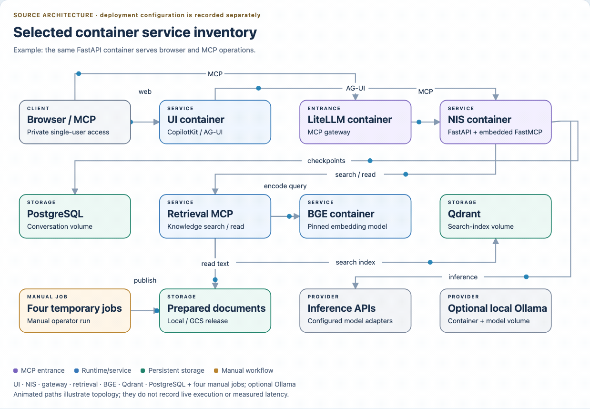

# Container and service inventory

[Home](../../README.md) · [Architecture](../../architecture/Architecture%20Concept.md) · [Setup](../README.md)

A question reaches one NIS assistant, then shared Retrieval MCP and the answer provider. For example, a browser question and a gateway UUID follow-up continue the same assistant conversation. This page owns the [Compose](../../compose.yaml) service boundaries; [Coordination](coordination.md) owns the client contract.

[Local browser version](../../architecture/diagrams/container-service-inventory.html)

## Service inventory

| Service | Lifecycle | Owns |
| --- | --- | --- |
| [UI](ui.md) | Persistent | Browser interaction and authenticated server proxy |
| [Coordination](coordination.md) | Persistent | One assistant, Deep Agent, model selection, embedded FastMCP and conversation lifecycle |
| LiteLLM gateway | Persistent | Shared MCP entrance to embedded FastMCP |
| [Retrieval MCP](knowledge-retrieval.md) | Persistent | Search/read over the pinned prepared release |
| Shared BGE | Persistent | Query/document encoding with one pinned model |
| [Qdrant](qdrant.md) | Persistent | Derived dense/lexical search index |
| [PostgreSQL](postgresql.md) | Persistent | Assistant checkpoints and stored ownership records |
| [Four ingestion workers](ingestion.md) | Temporary | Conversion, preparation, embedding and import/verification |
| Admin | On demand | Verification and supported activation operations |
| Local Ollama | Optional profile | Local inference when explicitly configured |

## Shared BGE capacity

Retrieval calls BGE in query mode; the batch worker calls it in document mode. Both use the same pinned model revision, vector dimensions, normalization and compatible input limits. Query instructions remain specific to query encoding.

Bound batch size, outstanding requests and worker concurrency. The shared service needs admission control that preserves interactive capacity and applies backpressure to batch callers; jobs must throttle or pause under load. The exact limits, priority mechanism, timeout and retry policy require measurement. Test query latency during an import before enabling concurrent use.

## Storage and inference outside container boundaries

| Resource | Owner and purpose | Placement |
| --- | --- | --- |
| Original documents | Operator; unchanged source versions | Existing source storage |
| Prepared full documents and manifest | Preparation; full text and source identity for Retrieval `read` | Local retained release; dedicated GCS bucket pending |
| Extracted text, chunks, vectors and job reports | Manual ingestion; durable stage handoffs and recovery evidence | Job artifact storage, mounted or accessed by API |
| Search index | Qdrant; derived data rebuildable from prepared artifacts | Qdrant data volume |
| Conversation checkpoints | PostgreSQL; independent from ingestion state | PostgreSQL data volume |
| BGE model files | Shared BGE server; pinned model and receipt | Model cache volume |
| Ollama Cloud | External answer inference route | Provider API outside the Docker host |
| Fireworks.ai | External answer inference route | Provider API outside the Docker host |

GCS and filesystem/database volumes are storage, not Docker containers. The selected target uses a dedicated GCS bucket for prepared full documents; the private retained-corpus deployment currently uses local prepared files. Original documents, prepared full text, vectors and the live search index have distinct lifecycles. No ingestion broker or scheduler is selected.

## Current implementation

Root Compose currently defines seven default persistent containers: ui, coordination (NIS Assistant), gateway, retrieval, bge, postgres and qdrant. The separate LiteLLM gateway forwards to embedded MCP. The `coordination` service serves the single NIS assistant. Four distinct temporary job services (job-convert, job-prepare, job-embed, job-import) live under the ingestion profile; the host-side scripts/knowledge-update launcher runs them in order, verifies their manifests and activates the new release atomically. The admin profile still supports verification; optional ollama uses local-model.

The retrieval service calls the shared bge service for query encoding. The batch embedding job calls the same service in document mode. Both modes share the pinned model revision, dimension and normalization; query instructions are applied only in query mode.

Prepared full documents use the local filesystem in this slice. The dedicated GCS bucket selected in D169 is the production target and is supported at the source level through a generation-conditional cloud activation pointer (`gs://bucket/object`) that Retrieval consumes. A `FakeGCSClient` double supports local verification. A real GCS bucket, credentials and upload smoke check remain external.

The backend image is shared by Coordination, Retrieval and admin, while their containers remain independent. Current mounts include `.runtime/data`/`NORA_RELEASES_ROOT`, `.runtime/models/bge`, `.runtime/state` for the Coordination request counter, and `.runtime/secrets` mounted where needed. `scripts/docker_acceptance.sh` provides a bounded, unique-project acceptance run that starts only the services needed for the four-job pipeline and cleans up its own resources.

Current Compose publishes only UI 8080 and Retrieval 8001 on host loopback. Coordination and both databases stay internal. Tailscale is the selected private communication path (D168); [setup](../README.md#private-access-with-tailscale) owns the access configuration. A connection from another Tailscale device remains to test. Automatic provider selection runs inside Coordination. Dedicated GCS deployment remains rollout work. Existing single-user credentials do not establish multi-user isolation.

[Configuration](../configuration.md) owns current settings, [setup](../README.md#run-the-application) owns current commands, and [deployment status](../private-deployment/STATUS.md) owns dated rollout and persistence evidence. The selected split is implemented in source; [private deployment status](../private-deployment/STATUS.md) and the [roadmap](../../Plan.md) own the remaining live verification and cleanup work.
