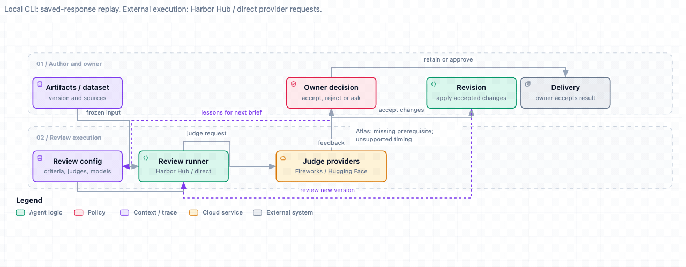

# Artifact evaluation and revision

[Workflows](../README.md) · [Evaluation](../../evaluation/README.md)

Improve an artifact through small, quick review cycles. For example, check an
Atlas release briefing against its source plan, correct a missing prerequisite
and carry the lesson into the next review brief.

## A simple example

The fictional Atlas source requires a passing load test **and** a completed
rollback rehearsal. The draft mentions only the load test.

| Feedback | Owner decision | Result |
| --- | --- | --- |
| Include the rollback rehearsal | Accept: required by the source | Add it in v2 |
| Promise release will take five minutes | Reject: no source supports the timing | Keep timing unknown |
| Add an existing open-questions section | Already resolved | Keep one section |

**Before**

> Atlas release requires a passing payment-service load test.

**After**

> Atlas release requires a passing payment-service load test and a completed rollback rehearsal.

Release duration remains unknown; the existing open-questions section is retained.
These are synthetic saved reviews, not live model calls.



[Local browser version](../../architecture/diagrams/artifact-review-flow.html)

## The workflow

1. **Configure:** freeze the artifact or dataset, source evidence and criteria;
   select judge perspectives, models and execution routes.
2. **Review:** send the same frozen input to each judge and keep its findings
   and references separate.
3. **Decide:** the owner checks each finding against the sources and current
   artifact, then accepts, rejects, marks already resolved or requests input.
4. **Improve:** apply accepted changes to a new version, or retain the current
   version when no change is useful. Keep useful lessons for the next brief.
5. **Reassess and deliver:** review again when useful; the owner accepts the result.

## Configuration and request flow

The local Atlas fixture and an external execution configuration share the same
review structure, but use different execution routes.

| Setting | Local Atlas fixture | External execution configuration |
| --- | --- | --- |
| Material / dataset | Release briefing v1 and its versioned source plan | Frozen artifact and source evidence |
| Task | Write a source-grounded Atlas release briefing | Define the artifact's purpose |
| Criteria | Factual support; both release prerequisites; usefulness to the release owner | Explicit, versioned criteria |
| Judges | One Evidence reviewer | Selected perspectives, such as factual and completeness reviewers |
| Model | `scripted-reviewer` | Explicitly selected model per judge |
| Runner | Local saved-response replay | Harbor Hub task or direct request |
| Provider | `synthetic-fixture`; no model request | Fireworks or Hugging Face Inference Providers |
| Output | Saved findings → owner decisions → briefing v2 | Findings per judge → owner decisions → retain or revise |

The [Atlas packet](../../examples/artifact-review/packet.json) contains the local
settings. External execution is a separate configuration; the local CLI does not
invoke these services.

The runner sends the artifact, evidence, criteria and assigned perspective to
its judge model. **Harbor Hub** is a task-execution option; **Fireworks** and
**Hugging Face Inference Providers** are model-execution options. Feedback
returns to the owner. Several perspectives from one model are correlated
opinions, not independent experts.

## Keep improving, keep building

There are two feedback loops: improve the artifact, and improve the next review
brief. The owner carries useful findings, rejected suggestions and decisions
forward. For Atlas, the next brief can explicitly ask judges to check **all**
release prerequisites and avoid inventing timings.

Each cycle improves the artifact and helps the owner write a better review
brief. The owner carries lessons forward by editing that brief. Keep task and
criteria fixed when comparing versions. A changed rubric gets a new version and
starts a new comparison.

**Example next review brief, edited by the owner:**

> Check every release prerequisite against the source plan. Do not infer release
> duration; flag missing timing as unknown.

This illustrates a lesson carried into a later cycle. The supplied Atlas v1/v2
packets keep the same task, criteria and rubric for comparison; they do not store
this next brief or automatically apply lessons.

## What is being evaluated?

| Quality question | What to check |
| --- | --- |
| Retrieval quality | Did search and read find the right evidence? |
| Generated-output quality | Does the artifact use that evidence accurately and serve the task? |

A valid report or higher model score does not prove improvement. Check the
revised artifact. Missing personal evidence stays a question for the person
concerned; it is not an invitation to invent facts.

## Local example

The current CLI validates saved responses and records explicit owner decisions;
it does not execute the external runner/provider routes shown above. The Atlas
reviews and decisions are synthetic fixtures, not a live judge or quality
benchmark. Run commands from the repository root with a new output directory.

For the complete two-version example:

```bash
nora review-example --output .private/atlas-review-cycle
```

Expected result: saved reviews, decisions, both artifact versions and a summary.
The accepted prerequisite is added; unsupported timing is rejected; the existing
section is not duplicated.

To inspect the same cycle step by step:

```bash
nora review-replay --packet examples/artifact-review/packet.json \
  --response examples/artifact-review/response.json --http-status 200 \
  --output .private/atlas-review
```

Expected result: frozen inputs, readable feedback and `requires_owner_review`.
Then record the decisions and explicitly authored next version:

```bash
nora review-revision --review .private/atlas-review \
  --decisions examples/artifact-review/decisions.json \
  --next-packet examples/artifact-review/packet-v2.json \
  --output .private/atlas-revision
```

Expected result: decisions, the supplied artifact and `revision_recorded`.

### Input and review contract

- **Frozen packet:** task, criteria, rubric version, artifact text/hash and
  anchors, source excerpts/hashes, judge perspective, provider and model.
  Exact packet bytes identify the reviewed input. Configuration and observed
  model identity are recorded separately; reasoning cannot replace final content.
- **Owner decisions:** include `packet_sha256` and `response_sha256` from the
  reviewed run's `state.json`, with every finding named once, a reason and one of
  `accept`, `reject`, `already_resolved` or `needs_input`. Files without the
  response hash are rejected; review the feedback before supplying that hash.
  Saved input hashes and feedback are checked against the original response.
- **Revision:** accepted changes require changed content and a new version.
  Retaining the artifact requires no accepted changes. Sources, task, criteria
  and reviewer configuration remain fixed for this comparison. The command
  records the supplied artifact; it does not edit it or verify semantic quality.
- **Scores and limits:** scores are ordinal model opinions from 1–4 or `null`,
  not acceptance thresholds. Failed reviews have no score. At most 20 findings
  and 1 MiB per input are accepted. A serialized report above that limit fails
  before replay reports success. Historical scores belong to their reviewed
  version. Existing output directories, including pending runs, are not overwritten.
- **Private storage:** supply credential-free captured responses and keep outputs
  private. These commands make no model calls or automatic retries and do not
  change conversations, corpus data, publication or deployment.

### Execution context

Fireworks reviews supplied feedback in a separate preparation project. Custom
Harbor Hub tasks and a Hugging Face adapter were also explored; their pilots did
not establish substantive reviews. These historical integrations are separate
from this harness's local commands and conversational answer repair.
