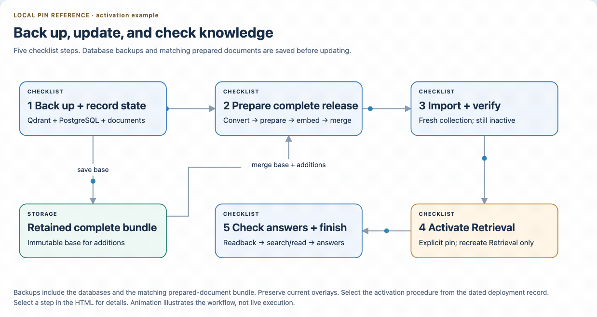

# Knowledge base update checklist

[How ingestion works](README.md) · [Job containers](../../setup/containers/ingestion.md) · [Deployment evidence](../../setup/private-deployment/STATUS.md)

Update knowledge deliberately, outside conversations. **Example:** add one revised project decision while keeping the existing corpus, then verify an answer about that decision.

## Current private deployment: local release pin

The latest saved deployment evidence uses a literal local Retrieval release-directory pin. GCS cutover remains pending. Read the latest deployment record and the installation's private operating guide for the actual release, collection, Compose files and backup locations; read them back on the host before a run.



[Local browser version](../../architecture/diagrams/ingestion-workflow.html)

> **Choose the complete release:** additions require assembly with the retained corpus. A full rebuild requires the complete desired source set. Running `knowledge-update` on additions alone creates a release containing only those additions. Assembly adds versions; it does not replace old versions or delete sources.

### 1. Back up and record the current state

- [ ] Record Retrieval's effective release directory, collection and document/point counts; confirm service health and no competing ingestion writer.
- [ ] Take a Qdrant collection backup/snapshot and a PostgreSQL backup using the installation’s database backup tools. Record completion, locations and checksums.
- [ ] Save the matching prepared-document bundle and effective deployment configuration alongside the backup record; full document text is stored outside the databases.
- [ ] Record the complete Compose file set, including all current Coordination repair overlays.
- [ ] Select immutable source versions and save their paths, sizes and checksums in the private run record.

**Expected result:** a recorded starting point and completed database backups with the matching prepared documents/configuration. Keep an immutable base bundle for assembly.

### 2. Prepare the complete release

For additions, run from the repository root in the configured Nora environment with the deployment's BGE settings. Paths below are examples; use fresh directories. Container installations use the corresponding [job containers and mounted paths](../../setup/containers/ingestion.md).

```bash
nora job convert ./selected-sources ./delta/extracted
nora job prepare ./delta/extracted ./delta/prepared
nora job embed ./delta/prepared --collection nora_delta_v2
nora assemble ./retained/prepared ./delta/prepared ./merged/prepared \
  --collection nora_merged_v2
```

**Expected result:** completed conversion/preparation/embedding reports and a self-contained merged bundle with `job-assemble.json`. The retained bundle remains unchanged. Nothing has been imported or activated.

For a full rebuild, run conversion, preparation and embedding against the complete desired source set into a fresh bundle. Skip assembly and substitute that complete bundle in step 3. See [processing and assembly contracts](README.md#add-documents-while-retaining-an-existing-bundle).

### 3. Import and verify

Use the deployment's Qdrant settings and a fresh collection name recorded in the bundle:

```bash
nora job import ./merged/prepared
```

- [ ] Check the completed `job-import.json`, prepared manifests, coverage and checksums.
- [ ] Compare expected document/point identities and counts; confirm the new collection's vector configuration and health.

**Expected result:** the complete new bundle and matching collection are ready. Running Retrieval still uses its old pin.

### 4. Activate Retrieval

- [ ] Prepare an explicit overlay pinning Retrieval to the verified complete release and its matching collection.
- [ ] Compare resolved Compose configuration before execution: retain every current overlay and change only the intended Retrieval release selection.
- [ ] Recreate only Retrieval using the installation's authenticated Compose command with the complete file set and these arguments:

```text
up -d --no-deps --no-build --pull never --force-recreate --wait retrieval
```

**Expected result:** Retrieval's effective release, collection and counts match the verified new bundle. Changing `current` or a GCS pointer does not switch a literal deployment pin. The arguments above are not a standalone command.

### 5. Check answers and finish

- [ ] Read back the active release/collection and counts; check search and one direct document read.
- [ ] Ask a bounded question and same-chat follow-up about the changed sources through the saved gateway. Check browser answer/reload when the browser is part of acceptance.
- [ ] Save actual results and deployment changes in the private run record; keep the backups and prepared-document copy according to the installation’s retention policy.

**Expected result:** the active release and representative answers pass, with the result recorded. If a check fails, leave the run marked incomplete and investigate the failed check. PostgreSQL conversation history is unchanged by ingestion.

## Future routine path: after GCS cutover

GCS is a separate deployment task. Complete bucket/IAM and keyless publisher setup, configure Retrieval to follow the pointer, and verify live publication and pointer selection before using it routinely. The [GCS reference](README.md#gcs-publication-reference) owns commands and prerequisites; it is not the current private deployment procedure.

## Current limitations

Additive assembly retains older content-addressed versions. Replacement/deletion, interrupted-run recovery and concurrent writers remain unverified. For replacement or removal, build a fresh complete desired dataset; a full rebuild does not establish resumability or concurrent-writer safety. Keep historical source dates when interpreting answers.
